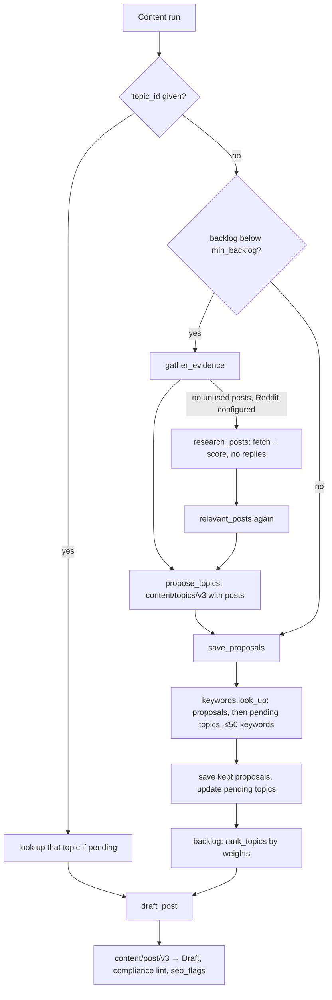

# Evidence-backed blog topics

The Content Agent proposes blog topics from the questions real people ask on Reddit, checks how many people search for each topic and how hard it is to rank, and drafts the topics with the strongest evidence first.

## Summary
Before this, blog topics came from the context documents alone, and their keywords were the model's guesses. Now each topic in the backlog carries evidence:
- **Reddit demand:** the posts asking that question, with links.
- **Search data:** monthly search volume and difficulty for its main keyword, in the project's market.

The agent drafts topics you requested first, then the best by an **opportunity** score. You decide how much search volume, ease of ranking and Reddit demand count, with plain Off/Low/Medium/High settings and three presets. When there's no Reddit evidence to use, the run fetches fresh posts itself. It drafts no replies; the next Reddit Agent run drafts replies for the worthwhile ones.

## Why
- **Topics were unbacked.** Nothing showed whether anyone was asking a question or searching for a keyword, so the backlog couldn't be prioritised on evidence.
- **Demand was already in the database.** The Reddit Agent collects and scores real audience posts, but that never reached the Content Agent.
- **Keyword guesses go stale fast.** A topic built around a phrase nobody types earns no search traffic, however good the article.

The work started from a discussion of content strategies (keyword-led, audience-question-led and others). The user chose to combine the two: questions from Reddit, checked against search data.

## How it behaves

**Where it lives:** the Content Agent page (sidebar → Agents → Content).
- **Configuration** gains **Search market**, **Search language** and **What matters most**.
- **Topic backlog** gains a **Sort by** control, plus search data and evidence on each topic.

**What a run does** (scheduled, or **Run now**):
1. **Gathers Reddit evidence.** It looks for posts that meet all of these:
   - scored at or above the Reddit Agent's relevance threshold
   - posted in the last 30 days
   - not already behind any topic, rejected topics included

   Posts whose reply was dismissed or never drafted still count: a question can be worth an article even when a reply wasn't worth posting.
2. **If none are found, does topic research.** When the Reddit Agent has subreddits and keywords configured, the run searches Reddit and scores the posts first. This happens even if the Reddit Agent is switched off. It never drafts replies.
3. **Proposes topics when the backlog is low**, as before. Similar posts are grouped into one topic, so you get "12 posts ask how to choose X", not twelve topics. Topics can also come from the context documents alone.
4. **Looks up search data** for the new topics, and for any topic whose data is still pending:
   - Each topic has up to 5 candidate keywords.
   - The one with the highest volume becomes its **primary keyword**.
   - Lookups use the project's market.
5. **Keeps or drops each new topic.** A topic with no Reddit evidence *and* zero search volume is dropped. A Reddit-backed topic with little search volume is kept and labelled **Low volume** (under 50 searches a month).
6. **Drafts the top `drafts_per_run` topics** in opportunity order. The post prompt is told the primary keyword.

**Drafting order:**
1. Topics you requested, oldest first.
2. Topics with search data, best opportunity first.
3. Topics whose search data is still pending, oldest first.

**What matters most:** three signals, each set to Off, Low, Medium or High.

| Signal | What it measures |
|---|---|
| Search volume | How many people search for the topic each month |
| Ease of ranking | How easy it is to reach the first page of results |
| Reddit demand | How many Reddit posts ask the question |

- The presets are **Balanced** (all Medium, the default), **Search first** (High / Medium / Low) and **Community first** (Low / Low / High).
- **Reset to default** appears once you move away from Balanced.
- **Off** removes a signal from the ranking.
- Saving reorders the backlog at once and changes which topic the next run drafts. Posts already drafted are unaffected.

**What each topic shows:**
- its primary keyword, "N searches/month · difficulty D/100" and the market it was looked up in (e.g. `US/en`)
- **Low volume** when it applies, or **Search data pending — looked up on the next run**
- **Asked in N Reddit posts**, which expands to links to each post
- its other keywords, as chips

**Sort by:** Best opportunity (the drafting order, the default), Search volume, Easiest to rank, Most Reddit posts, or Newest. When sorting by volume or difficulty, topics still waiting for search data go last.

**Rules and limits:**
- At most **50 keywords** are looked up per run. Topics that don't fit wait for a later run, and the run says how many were deferred.
- A topic is looked up **once**. Its search data is never refreshed.
- Changing the market affects later lookups only. Each topic shows the market it was looked up in.
- **Topics you request are never dropped**, even with zero volume. A topic you add with no keywords is looked up by its title.
- With **Draft now** on a requested topic, its search data is looked up just before drafting.
- A keyword the provider has no data for counts as **zero volume**. That's usually a phrase too rare for Google to report.

**When something is missing or fails:**
- **Reddit isn't configured, the search finds nothing relevant, or the search fails:** topics are proposed from the context documents as before, with search data. The run log says which reason applied. A failed search is a warning, not a failed run.
- **The keyword lookup fails:** topics are still proposed and drafted. They're marked pending, and the next run retries them. The run shows a warning.

**How it interacts with the Reddit Agent:**
- **Posts found by topic research still get replies.** The next Reddit Agent run takes them over and drafts replies for the reply-worthy ones, exactly as if it had found them itself. That works on both the manual and the scheduled (batch) paths.
- **No post is scored twice or replied to twice.** Posts that aren't reply-worthy appear in the Reddit Agent's skipped list as usual.

**SEO check on drafts:** besides the meta-description length check, a draft is flagged when the primary keyword is missing from its title, its first paragraph or every H2. A flag is a warning, never a block.

## Decisions
- **Reddit questions plus search data, together.** This is the user's choice: Reddit says what people really ask, and search data says what people look up. Rejected: keyword research alone, which favours generic topics everyone already targets, and Reddit alone, which can't tell whether an article will be found.
- **Keyword data from an Apify actor (`keywordlab/keyword-search-volume`).** It runs on the Apify account Luka already has, so there's no new account or service to run. That fits the operator's preference for no new infrastructure. Rejected: DataForSEO directly, which needs a new account and a $50 minimum balance. The actor reads DataForSEO's database anyway, so moving to DataForSEO later only means a new adapter.
- **Checked with a live run before building.** The actor is new, with few users. One real run confirmed volume, difficulty, the "no data" behaviour and ISO country codes, and showed that its first reported cost was out of date.
- **A Reddit-backed topic with low volume is kept.** A question a community keeps asking is worth answering even if nobody searches for it. The label is **"Low volume"**: the user found "no search demand" too alarming.
- **A topic needs some evidence.** No Reddit posts and zero volume means it's dropped. Requested topics are exempt, because you asked for them.
- **"No data" counts as zero volume.** The user's call: the provider has no data mainly for very rare phrases. A consequence is that such a topic is dropped unless Reddit backs it.
- **Weights the user sets, in plain terms.** What matters (search traffic or community demand) differs by business, so the PRD left the weighting open and the user asked for adjustable weights that are easy to use. Rejected: a fixed formula, and raw numeric weights. The scales are deliberately uncapped, so a topic better on one signal and equal on the others always ranks higher.
- **Ranking computed when the backlog is read, not stored.** A weight change reorders everything at once (AC-9b), with nothing to recompute.
- **Topic research fetches its own posts when there are none.** This is the user's addition to the PRD. Without it, a project whose Reddit Agent hasn't run recently would never get Reddit evidence.
- **Posts found by topic research get replies on the next Reddit run.** This is the user's choice. The alternative was to treat them as already seen, which would have quietly taken reply opportunities away from the Reddit Agent, because its duplicate check skips known posts.
- **Topic research runs even if the Reddit Agent is disabled**, as long as subreddits and keywords are configured. Configured targets show the user wants Reddit as a source.
- **Search data is looked up once and never refreshed.** That keeps spend predictable. Rejected: periodic refresh, left out of scope.
- **No backfill of existing topics.** The only user cleared the backlog before using the feature. AC-15 was dropped before agreement.
- **The model doesn't decide how many topics are kept.** Proposals are cut to `topics_per_run` after removing duplicates, not before. Cutting first would have discarded good proposals that came after duplicates.

## How it works

### Flow

A later Reddit run calls `take_over_research_posts`, claims the scored posts found by topic research, and passes them to `draft_replies` along with its own posts.

### Data model
- **`BlogTopic`** (`apps/content/models.py`):
  - `evidence_posts`: a many-to-many link to `RedditPost`, reverse name `blog_topics`
  - `search_status`: `pending` or `ready`
  - `keyword_metrics`: a JSON list of `{keyword, volume, difficulty}` for every candidate looked up
  - `primary_keyword`, `search_volume`, `keyword_difficulty`
  - `search_market`: e.g. `US/en`
  - `search_checked_at`
  - `low_volume`: a property, true when ready and the volume is under `LOW_VOLUME_THRESHOLD` (50)
- **`RedditPost`** (`apps/reddit/models.py`):
  - `found_by`: `reddit` or `topic_research`
  - `handoff_run`: the Reddit run that took the post over. Each post is claimed once.

Migrations: `content/0002_topic_evidence_and_search_data`, `reddit/0002_post_found_by_and_handoff`.

### API
- **`GET /api/agents/content/topics/`** takes `?status=` and `?sort=opportunity|volume|difficulty|evidence|newest` (default `opportunity`). An unknown sort returns a 400.
  - Each topic adds `evidence` (`id`, `subreddit`, `title`, `url`), `evidence_count`, `search_status`, `primary_keyword`, `search_volume`, `keyword_difficulty`, `search_market` and `low_volume`.
- **`POST /api/agents/content/topics/`** requests a topic. `target_keywords` is now a list of at most 5 strings, each at most 80 characters.
- **`PATCH /api/agents/content/`** (the generic agent config endpoint) accepts `search_country`, `search_language` and `weights`, validated by `ContentAgentConfig`.

### Pipelines and tasks
All of this runs inside the existing content run (`run_content_agent`). There are no new Celery tasks.

- **`apps/content/research.py`:**
  - `relevant_posts` selects the evidence: at most 60 posts, the most relevant first.
  - `gather_evidence` falls back to topic research and reports why when there's no evidence.
  - `prompt_posts` escapes the post text for the prompt.
- **`apps/content/pipeline.py`:**
  - `propose_topics` checks evidence ids, assigns each post to one topic and removes duplicates.
  - `save_proposals` runs the lookup and the drop rule.
  - `ensure_search_data` handles a single requested topic.
  - `backlog` returns the drafting order.
  - `keyword_placement` and `seo_flags` do the keyword check.
- **`apps/content/keywords.py`:**
  - `candidate_keywords`: valid keywords, or the title as a fallback.
  - `look_up`: one provider call within the budget.
  - `search_data_for` and `choose_primary`: highest volume, then known lower difficulty, then the earlier candidate.
- **`apps/content/opportunity.py`:**
  - `signals`: volume is `log10(v+1)/5`, ease is `(100−difficulty)/100` (0.5 when unknown), Reddit demand is `n/(n+3)`.
  - `opportunity`: the weighted mean.
  - `rank_topics`: the drafting order.
- **`apps/reddit/pipeline.py`:**
  - `research_posts` is the fetch and score for topic research.
  - `take_over_research_posts` is called from both `run_reddit_agent` and `finish_batch_run`.
  - `fetch` now takes `found_by`.
  - `safe_post_url` keeps only http(s) URLs.

### LLM calls
- **`backend/prompts/content/topics/v3.md`:**
  - Writer tier, 8000 max tokens, medium effort, schema `TopicProposals`.
  - Input: titles already covered, rejected titles, and the posts as `<post id subreddit>` blocks. Each block holds the title plus a body excerpt of up to 500 characters, HTML-escaped.
  - Output: each `TopicProposal` adds `evidence_post_ids`. `target_keywords` is described to the model as search phrases.
- **`backend/prompts/content/post/v3.md`:** the user message gains `Primary keyword: …`.
- **Topic research scoring** reuses `reddit/score` (fast tier), one synchronous call per new post. The number of posts is bounded by the Reddit Agent's `max_posts_per_run`.
- v2 of both content prompts was deleted. Content runs don't use batches.

### Keyword provider
`backend/providers/keywords/` contains:
- `base.py`: `KeywordSource`, `KeywordQuery`, `KeywordLookupResult`, the `MARKETS` and `LANGUAGES` allowlists, and `normalize_keyword`.
- `apify.py`: `ApifyKeywordSource`.
- `fake.py`: `FakeKeywordSource`.

`ApifyKeywordSource` works like this:
- It lowercases and dedupes keywords, drops any over 80 characters or 10 words, and turns off live Google lookups.
- It reads the dataset, and works out "no data" only from a run that succeeded.
- It re-reads the finished run for its final cost (`providers/apify_runs.settled_run`).

### Frontend
- `frontend/src/features/agents/TopicBacklog.tsx`: the sort control, `TopicMetrics`, `TopicEvidence`, and the keyword chips minus the primary keyword.
- `frontend/src/features/agents/ConfigForms.tsx`: in `ContentConfigForm`, the market and language selects and `WeightsField` with presets and reset.
- `frontend/src/lib/types.ts`: `SEARCH_MARKETS` and `SEARCH_LANGUAGES` mirror the backend allowlists.
- `frontend/src/lib/queries.ts`: `useTopics(status, sort)`. Saving content settings invalidates the topic list.

### Configuration
| Setting | Default | Meaning |
|---|---|---|
| `KEYWORD_SOURCE` | `apify` | `apify` or `fake` (no spend) |
| `APIFY_KEYWORD_ACTOR` | `keywordlab/keyword-search-volume` | The keyword actor |
| `KEYWORD_LOOKUPS_PER_RUN` | 50 | Keywords per content run (code constant) |
| `APIFY_KEYWORD_MAX_CHARGE_USD` | 0.50 | Charge cap per lookup |
| `APIFY_REDDIT_MAX_CHARGE_USD` | 1.00 | Charge cap per Reddit search |
| `APIFY_REDDIT_MAX_ITEMS` | 500 | Result cap per Reddit search |

Per-project `ContentAgentConfig` fields:
- `search_country`: `US` by default, one of 28 ISO codes
- `search_language`: `en` by default
- `weights`: `volume`, `ease` and `reddit`, each `medium` by default

`RedditAgentConfig` now allows at most 20 subreddits in Reddit's name format, and at most 30 keywords of at most 80 characters each.

## Security and tenancy
- **Tenancy:**
  - Everything is scoped from `run.project`, or from `current_project(request)` in the view.
  - Evidence ids from the model are kept only if they were among the posts sent in this run, so another project's post can never be linked.
  - The view's evidence prefetch is also filtered by project.
- **New trust boundary:** the keyword provider receives topic keywords and the titles of topics a user requests. `docs/security-patterns.md` was updated:
  - §1: a new trust boundary row
  - §6: `ApifyKeywordSource` sends no URLs
  - §7: two new allowlist rows, for evidence ids and for model output triggering a keyword lookup
  - §10: the third parties that receive content
  - §11: the new spend bounds
- **Fixed in the same PR, and removed from §14:**
  - unbounded Reddit spend: config limits plus result and charge caps
  - `RedditPost.url` scheme: checked on write and on read, everywhere a post link is rendered
  - untyped requested-topic keywords
  - the model deciding how many blog topics are saved
- **Bounded by the hourly schedule minimum:** a Content Agent schedule with Reddit targets that never yield relevant posts repeats a Reddit search, its scoring and a keyword lookup on every run. Each run is bounded, and since agent schedules can run at most once an hour (`docs/features/friendly-agent-schedules.md`), so is the repetition.

## Observability
Everything is in the content run's activity trail (`RunEvent`):
- "Researching topics on Reddit: …", then the usual Reddit search and scoring events
- "Using N Reddit post(s) as evidence", or "No Reddit evidence used: …" with a `reason`
- "Model proposed N topic(s) from M of K post(s)", with `groups` (title and post count per topic)
- "Looking up search data for N keywords", then the Apify usage event (with/without data, cost)
- "Search data pending for N topic(s)", with `deferred` and `failed` counts
- "Proposed N new topic(s), dropped M with no Reddit evidence and no search volume"

**`run.stats` keys:**
- evidence: `posts_considered`, `no_evidence_reason`, `posts_grouped`, `topics_with_evidence`
- proposals: `topics_proposed`, `topics_duplicate`, `topics_no_demand`
- lookups: `keywords_looked_up`, `topics_lookup_deferred`, `topics_lookup_failed`
- on Reddit runs: `carried_over`

**Spend** is recorded in `ExternalUsage` and shows in Stats under `apify_by_purpose`:
- `keyword_lookup`
- `reddit_topic_research`
- `reddit_search` (the Reddit Agent's own searches)

## Testing
- `backend/tests/test_content_research.py` covers every AC that has a test: evidence selection, grouping, drop and Low volume, requested topics, market, budget, failures, spend, ranking and weights, sorting, evidence links, research and handoff (sync and batch), the keyword placement check, Reddit config limits, and stored-URL safety.
- `backend/tests/test_keyword_adapter.py`: input mapping and limits, output mapping, settled cost, failures.
- `backend/tests/test_tenancy.py` (`test_topic_evidence_and_sorting_are_scoped`, plus topic draft across projects).
- `backend/tests/test_reddit_adapter.py` (`test_search_passes_both_spend_caps`).
- `backend/tests/test_content_agent.py` was updated for the new stats and the keyword flag.
- **Checked by hand** in the local app: the evidence list (AC-4), the presets and weight controls (AC-9a) and sorting (AC-10).
- **Live check:** one run of the keyword actor before building.
- **Tests never spend money:** `config.settings.test` clears `APIFY_TOKEN` and forces fake providers.

## Limitations and follow-ups
- **Topic research can repeat on every run**, at most once an hour. See Security.
- **The keyword actor is young** (few users, no rating). If it degrades, a DataForSEO adapter is the natural replacement.
- **The keyword placement check is literal.** It matches the exact phrase, so a natural variant (a plural, a different word order) is flagged.
- **Search data is never refreshed**, so a topic that waits months shows old numbers.
- **The market lists are duplicated:** `SEARCH_MARKETS` in the frontend mirrors `MARKETS` in the backend by hand.
- **Not built (PRD out of scope):** SERP or competitor analysis, rank tracking, question sources other than Reddit, and open-ended keyword research.

## Where to look
| What | Where |
|---|---|
| Run orchestration | `backend/apps/content/pipeline.py` (`run_content_agent`, `propose_topics`, `save_proposals`) |
| Reddit evidence | `backend/apps/content/research.py` (`gather_evidence`, `relevant_posts`) |
| Keyword lookup | `backend/apps/content/keywords.py` (`look_up`, `candidate_keywords`) |
| Ranking | `backend/apps/content/opportunity.py` (`rank_topics`, `signals`) |
| Settings per project | `backend/apps/content/config.py` (`ContentAgentConfig`, `OpportunityWeights`) |
| Keyword provider | `backend/providers/keywords/` |
| Research fetch and reply handoff | `backend/apps/reddit/pipeline.py` (`research_posts`, `take_over_research_posts`) |
| Topic API | `backend/apps/content/views.py` (`TopicListView`, `BlogTopicSerializer`) |
| Prompts | `backend/prompts/content/topics/v3.md`, `backend/prompts/content/post/v3.md` |
| Backlog UI | `frontend/src/features/agents/TopicBacklog.tsx` |
| Settings UI | `frontend/src/features/agents/ConfigForms.tsx` (`WeightsField`) |
| Agreed scope | `docs/prds/0001-evidence-backed-topics.md` |

## History
- 2026-10-13 · #14 · First version: Reddit evidence, keyword search data, opportunity ranking, topic research with reply handoff.
